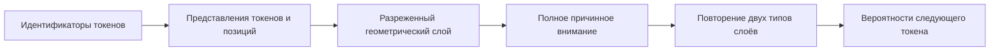

# SpatialLM-Mini

**Небольшие языковые модели с разреженным геометрическим вниманием — для экспериментов на видеокарте с 8 ГБ памяти.**

[English](README.md) · [Результаты и протокол](SUBWORD16K_RESULTS.md) · [Как участвовать](CONTRIBUTING.md) · [Лицензия MIT](LICENSE)

**Автор: [Vladimir Ivlev](https://github.com/ivlev8721-blip), псевдоним — Ivlev8721.**

SpatialLM-Mini — работающий исследовательский прототип на Python/PyTorch. Его задача — проверить практический вопрос: **может ли маленькая языковая модель быстрее обучаться на длинном тексте, если токены обмениваются информацией через разреженный граф, а веса связей определяются обучаемыми расстояниями в 3D?**

В проекте есть обучение с нуля, генерация текста, контрольный Transformer с полным вниманием, гибрид двух архитектур, воспроизводимые эксперименты и автоматические тесты. Код рассчитан на изучение и изменение на обычном персональном компьютере.

> **Это исследовательский прототип, а не универсальный ассистент.** Пока сравнивались три модели примерно по 9,32 млн параметров на одном романе. Эти результаты не доказывают превосходство над существующими разреженными архитектурами, отдельную пользу 3D-координат или новый мировой рекорд.

## Идея простыми словами

При полном внимании каждый токен может обращаться ко всем предыдущим. Это гибко, но вычисления быстро дорожают с увеличением текста.

В пространственной модели у каждого токена меньше связей: с ближайшими предыдущими токенами и позициями на расстояниях 1, 2, 4, 8 и далее. Обучаемые трёхмерные координаты запроса и ключа определяют силу взаимодействия. **Набор связей фиксирован, а их веса зависят от текста.**

Гибрид чередует пространственные слои со слоями полного внимания, периодически предоставляя доступ ко всем предшествующим позициям.



На схеме показан гибрид. Пространственная модель использует только пространственные слои, контрольный Transformer — только полное внимание. В каждом блоке также есть нормализация, остаточные связи и полносвязная сеть.

## Что уже измерено

Предварительный опыт выполнен на **NVIDIA RTX 3050 с 8 ГБ VRAM**, Windows и PyTorch 2.10.0+cu128. Контекст — **16 384 subword-токена GPT-2**, три начальных состояния генератора случайных чисел: 42, 43 и 44. Все модели обучались с нуля. От GPT-2 взят только токенизатор, предобученные веса не используются.

Ниже — среднее по трём запускам после **180 секунд накопленного времени шагов обучения на модель**. Чем меньше ошибка на test, тем лучше.

| Модель | Параметров | Обучающих токенов/с | Скорость относительно Transformer | Test loss, среднее ± SD | Пик выделенной памяти |
|---|---:|---:|---:|---:|---:|
| Transformer | 9 323 392 | 13 126 | 1,00× | 5,2176 ± 0,0087 | 499,1 МиБ |
| Пространственная | 9 323 248 | **32 364** | **2,47×** | 4,8771 ± 0,0148 | 671,1 МиБ |
| Гибрид | 9 323 320 | 18 725 | 1,43× | **4,8689 ± 0,0125** | 657,2 МиБ |

**Подтверждённое преимущество — скорость обучения на этой конфигурации.** Размер моделей практически одинаков. Пространственная модель потребовала больше выделенной памяти, чем оптимизированный Transformer. Скорость пошаговой генерации пока не сравнивалась.

После одинаковых **100 обновлений** test loss составила 5,6905 у Transformer, 5,6527 у пространственной модели и 5,6394 у гибрида. Более заметное преимущество при одинаковом времени отчасти объясняется тем, что быстрые модели успевают сделать больше обновлений.

Корпус — роман Джейн Остин «Гордость и предубеждение», разделённый на последовательные train/validation/test части. Оценка каждой модели использует одинаковые 16 384 целевые позиции. В измерение времени входят выбор данных, передача на GPU, прямой и обратный проходы, пересчёт активаций, ограничение градиента и обновление параметров. Прогрев, оценка, сохранение и генерация исключены. Память — выделенная PyTorch память, а не вся занятость видеокарты. SD по трём повторам не является доверительным интервалом.

Доступны [полный русский отчёт](SUBWORD16K_RESULTS.md), [английское описание опыта](docs/EXPERIMENTS.md), [исходные измерения](results/subword16k_v1/results.json) и [протокол](results/subword16k_v1/protocol.json).

## Быстрый запуск

Склонируйте репозиторий или скачайте ZIP и откройте терминал в корне проекта. В описании пакета указана поддержка Python 3.10–3.13; записанный GPU-опыт и локальные проверки выполнены на Python 3.13.14. Команды ниже устанавливают проверенную версию PyTorch. Для GPU нужен совместимый драйвер NVIDIA; отдельный CUDA Toolkit для этих готовых пакетов не требуется.

### Windows / PowerShell: демо на CPU

```powershell
python -m venv .venv
.\.venv\Scripts\python.exe -m pip install torch==2.10.0 --index-url https://download.pytorch.org/whl/cpu
.\.venv\Scripts\python.exe -m pip install numpy==2.2.6 -e ".[subword]"
$env:PYTHONUTF8 = '1'
.\.venv\Scripts\python.exe -m unittest discover -s tests -v
.\.venv\Scripts\python.exe -m spatiallm.train --config configs/tiny.json --device cpu --out runs/demo
.\.venv\Scripts\python.exe -m spatiallm.generate --checkpoint runs/demo/last.pt --prompt 'The blue ' --max-new-tokens 120
```

### Linux / bash: демо на CPU

```bash
python3 -m venv .venv
.venv/bin/python -m pip install torch==2.10.0 --index-url https://download.pytorch.org/whl/cpu
.venv/bin/python -m pip install numpy==2.2.6 -e '.[subword]'
.venv/bin/python -m unittest discover -s tests -v
.venv/bin/python -m spatiallm.train --config configs/tiny.json --device cpu --out runs/demo
.venv/bin/python -m spatiallm.generate --checkpoint runs/demo/last.pt --prompt 'The blue ' --max-new-tokens 120
```

Маленькое демо использует **байтовые токены и короткий контекст** на повторяющихся синтетических примерах. Оно проверяет работоспособность обучения, но не воспроизводит результат 16K. Генерация может содержать повторы и ошибки. CUDA-тесты пропускаются на CPU. Команды Linux приведены для переносимости; опубликованные замеры сделаны на Windows.

### Видеокарта NVIDIA и опыт на 16K

В новом GPU-окружении вместо CPU-сборки установите проверенную CUDA-сборку:

```powershell
.\.venv\Scripts\python.exe -m pip install torch==2.10.0 --index-url https://download.pytorch.org/whl/cu128
.\.venv\Scripts\python.exe -m pip install numpy==2.2.6 -e ".[subword]"
.\.venv\Scripts\python.exe -c "import torch; print(torch.__version__); print(torch.cuda.is_available())"
# Сначала проверка памяти и доступности алгоритма внимания: по три шага.
.\.venv\Scripts\python.exe -m spatiallm.subword16k pilot --steps 3 --seeds 42 --out runs/pilot_16k
# Девять последовательных обучений: три архитектуры и три seed.
.\.venv\Scripts\python.exe -m spatiallm.subword16k run --steps 100 --seconds 180 --seeds 42 43 44 --out runs/subword16k_repeat
# Генерация из состояния, полученного вашим запуском.
.\.venv\Scripts\python.exe -m spatiallm.subword16k generate --checkpoint runs/subword16k_repeat/hybrid_seed42/equal_time.pt --prompt 'Elizabeth ' --count 64
```

В Linux замените `.\.venv\Scripts\python.exe` на `.venv/bin/python`. Не запускайте GPU-опыты одновременно. На исходном компьютере девять запусков требуют примерно 27 минут измеряемого обучения плюс подготовка, оценка и сохранение; другое железо и фоновая нагрузка меняют время.

Для 16K включены FP16 autocast с FP32 весами/AdamW, пересчёт промежуточных данных при обратном проходе и расчёт выходного слоя порциями по 512 позиций. **В cross-entropy участвуют все целевые позиции и весь словарь из 50 257 токенов.** В Transformer-слоях принудительно используется PyTorch `EFFICIENT_ATTENTION`, чтобы исключить незаметный переход на алгоритм с квадратичным расходом памяти. В исходной Windows-сборке FlashAttention не был скомпилирован. Если Efficient Attention недоступен, пилот завершится ошибкой; для полного опыта требуется поддерживаемая CUDA-конфигурация. Справка: [установка PyTorch](https://pytorch.org/get-started/previous-versions/), [SDPA](https://docs.pytorch.org/docs/stable/generated/torch.nn.functional.scaled_dot_product_attention.html).

Каждому опыту задавайте новый каталог вывода. Веса создаются локально и исключены из Git. Снимки опыта 16K содержат веса и сведения для оценки/генерации, без optimizer/RNG для продолжения обучения. Байтовый тренер поддерживает полное сохранение и продолжение.

Точные версии исходного CUDA-окружения — в [requirements-lock-subword-cuda.txt](requirements-lock-subword-cuda.txt). Дополнительные команды — в [руководстве 16K](SUBWORD16K_GUIDE.md).

## Данные и воспроизводимость

- Включены исходный текст Gutenberg, неизменённые UTF-8 части, описание токенизации и подготовленные GPT-2 ID. Хеши позволяют определить точный корпус опыта.
- При первом использовании `tiktoken` скачивает файлы GPT-2 токенизатора: для этого нужен интернет. Локальный кэш исключён из Git. Предобученные веса модели не скачиваются.
- Повторная подготовка в новом каталоге: `python -m spatiallm.subword16k prepare --text data/natural --data data/subword16k_rebuilt`.
- Байтовое обучение на своём UTF-8 тексте: `python -m spatiallm.train --config configs/tiny.json --data data/my_text.txt --device cpu --out runs/my_corpus`.
- Набор из 25 тестов проверяет причинность, топологию, градиенты координат, эквивалентность ошибки/градиентов при экономном расчёте, токенизацию, генерацию, продолжение обучения и работу на CUDA. CUDA-проверки пропускаются без CUDA. Добавлен автоматический CPU-процесс GitHub Actions; он не повторяет GPU-бенчмарк.
- На исходном компьютере прошли все 25 тестов. Повторно загружены 18 снимков моделей; каждая архитектура выполнила генерацию с активным окном 16 384 токена. [Результаты заключительных проверок](results/subword16k_checks/verification.json).
- Seed и детерминированные настройки повышают воспроизводимость в одном окружении. Другое железо, драйверы, ядра и версии пакетов могут менять результаты. При одинаковом времени возможны разные числа шагов.

[Происхождение данных](data/README.md) и условия сторонних материалов рассматриваются отдельно от лицензии кода.

## Как устроено пространственное внимание

В каждом слое и голове скрытое состояние проецируется в две трёхмерные координаты: запроса и ключа. Для разрешённых причинных связей:

```text
q, k = tanh(обучаемые проекции координат)
score(t,j,h) = -exp(clamp(log_scale[h])) * squared_distance(q[t,h], k[j,h])
               + learned_edge_bias[h, offset(t,j)]
weights = softmax(оценки разрешённых соседей)
output[t] = projection(sum_j weights[t,j] * values[j])
```

Граф содержит связь с собой, локальные и степенные по двойке связи. Повторы удалены, будущие позиции закрыты маской. Глобального поиска ближайших соседей нет. При `K = O(local_window + log(max_seq_len))` геометрическое смешивание стоит `O(B*T*K*D)` и не создаёт полную матрицу `T×T`. Проекции и полносвязные сети по-прежнему используют матричные умножения. Сбор соседей создаёт промежуточные тензоры; поэтому меньше операций не обязательно означает меньше памяти по сравнению с оптимизированным полным вниманием.

«Пространственная» здесь означает скрытые координаты для взвешивания взаимодействий токенов. Это не рендеринг полигонов, не физическая 3D-модель, не трассировка лучей и не использование RT-ядер. Репозиторий не связан с другими проектами, которые могут называться SpatialLM.

## Ограничения и полезные следующие эксперименты

- Один роман, маленькие модели, три повтора и короткое обучение. В генерации есть повторы и нарушения связности.
- Входное окно 16K не доказывает способность извлекать далёкие факты или рассуждать о них.
- Пока нет сравнения с тем же графом без координат и с обычным локальным вниманием. Приписывать ускорение именно геометрии нельзя.
- Для почти одинакового числа параметров ширина FFN различается: 628 / 512 / 570 у пространственной модели / Transformer / гибрида. Это дополнительное различие архитектур.
- Используются обучаемые абсолютные позиции. RoPE и другие более сильные контрольные варианты не проверялись.
- Нет KV-кэша, специального разреженного CUDA-ядра, распределённого обучения и замеров скорости генерации.
- Ранние байтовые опыты отличаются словарём, размером модели, точностью вычислений и процедурой оценки. Их loss/perplexity нельзя напрямую сравнивать с таблицей GPT-2 токенов.

Особенно полезны отключение геометрии при неизменном графе, проверка дальних зависимостей, другие корпуса, профилирование, инкрементальная генерация и независимые повторения. Подробности — в [CONTRIBUTING.md](CONTRIBUTING.md).

## Близкие работы

Разреженное и гибридное внимание — известные исследовательские направления. Полезные ориентиры: [Longformer](https://arxiv.org/abs/2004.05150), [BigBird](https://arxiv.org/abs/2007.14062), [Routing Transformer](https://aclanthology.org/2021.tacl-1.4/), [LongNet](https://arxiv.org/abs/2307.02486) и чередование локального/глобального внимания в [Gemma 2](https://arxiv.org/abs/2408.00118). Прямого сравнения с ними в этом проекте не было. Новизна конкретной комбинации пока не установлена.

## Структура проекта

| Путь | Назначение |
|---|---|
| `spatiallm/model.py` | Пространственное и полное внимание, гибридные блоки, loss порциями |
| `spatiallm/train.py`, `generate.py` | Байтовое обучение, продолжение и генерация |
| `spatiallm/subword_data.py`, `subword16k.py` | GPT-2 токены, опыт 16K и генерация |
| `spatiallm/experiment.py`, `benchmark.py` | Ранние опыты качества и замеры скорости |
| `configs/` | Небольшие CPU/GPU настройки и контрольные варианты |
| `tests/` | Автоматические проверки |
| `data/` | Демо, исходный текст, части, токены и происхождение |
| `results/` | Записанные протоколы и измерения без весов моделей |
| `tools/` | Подготовка данных, отчёты и локальная проверка снимков |
| `docs/EXPERIMENTS.md` | Английское описание опыта и воспроизводимости |

## Авторство и лицензия

**Автор проекта — Vladimir Ivlev (Ivlev8721).** Copyright © 2026 Vladimir Ivlev.

Код и оригинальная документация доступны по [лицензии MIT](LICENSE). При распространении существенных частей необходимо сохранять уведомления об авторских правах и разрешении. Сторонние тексты, файлы токенизатора и зависимости сохраняют собственное авторство и условия: [THIRD_PARTY_NOTICES.md](THIRD_PARTY_NOTICES.md). Автор проекта не заявляет авторство на перечисленные выше известные методы внимания.
